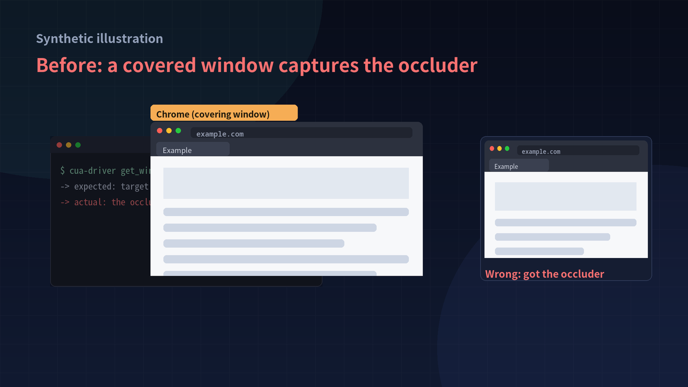
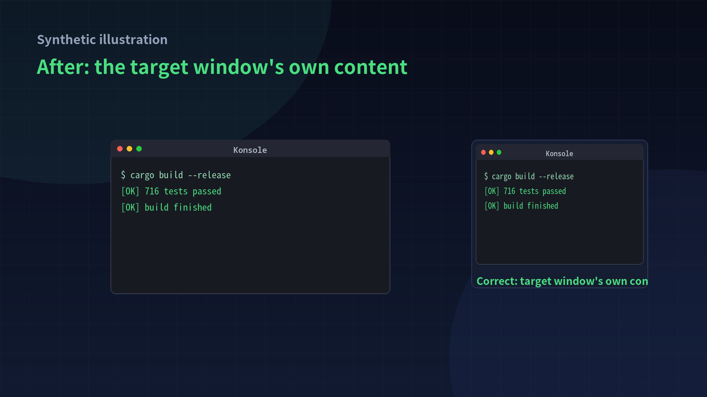

# cua-x11-window-capture-fix（中文）

[English](README.md) | 中文

针对 **Cua Driver** 的 Linux X11 临时修复：当目标窗口**被其他窗口遮挡**时，窗口截图会错误地截到遮挡它的窗口，而不是目标窗口自己的内容。

已在 **KWin 5.27（X11，gl2 合成器）** 上针对 Cua Driver `0.38.0`（main `7c465d5`）验证，并回移到 `cua-driver-rs-v0.37.0`。

> 与 Cua / trycua 官方无关。本仓库只承载补丁、文档和 Release 中的预编译产物；上游项目：<https://github.com/trycua/cua>。

## 问题现象

在 X11 且启用合成器（compositing）的桌面上，对被遮挡窗口调用 `get_window_state`（或任何窗口截图路径），得到的图片是遮挡它的窗口。例如：被全屏 Chrome 完全盖住的 Konsole，截图返回的是 Chrome 页面。

## 根因（两个叠加的问题）

1. **读取的 drawable 不对**：窗口管理器会把 client 窗口 reparent 进 frame 窗口，合成器重定向的是 **frame**。直接读 client drawable 时，遮挡区域是 undefined 像素（在 KWin 上等于屏幕内容）。修复方式是读取 `XCompositeNameWindowPixmap(frame)`，再裁出 client 区域。
2. **InputOnly 窗口被误判为“覆盖的 popup”**：驱动自身的 override-redirect `InputOnly` 光标/输入窗口没有像素，却被当成盖住目标窗口的 popup，导致 `get_window_state` 直接走整屏裁剪——这样第 1 个修复就不会生效。

两个修复都在本仓库的补丁中。原有的 `MIT-SHM → XGetImage → ImageMagick` 回退链保留，因此没有合成器的环境行为不变。

## 兼容性

| 项目 | 状态 |
|---|---|
| X11 / XWayland（X11 应用） | ✅ 修复生效 |
| Wayland 原生客户端 | ❌ 不涉及（没有 XID，超出范围） |
| 需要合成器 | ✅ 仅在合成器实际重定向窗口时有效 |
| 无合成器 / 窗口被 unredirect | 回退到旧的捕获路径 |
| 已验证的合成器 | 仅 KWin 5.27；Mutter/wlroots 未验证 |

## 使用 Release 里的二进制（最快，无需工具链）

Release 资产在 [Releases](../../releases) 页面。二进制面向 **linux x86_64**，**未签名**——使用前请核对 `SHA256SUMS`，有条件时优先自己从源码编译。

```sh
mkdir -p ~/cua-driver-patched && cd ~/cua-driver-patched
curl -LO https://github.com/amzzma/cua-x11-window-capture-fix/releases/download/v0.1.0/cua-driver-linux-x86_64-0.38.0-patched
chmod +x cua-driver-linux-x86_64-0.38.0-patched
./cua-driver-linux-x86_64-0.38.0-patched --version   # cua-driver 0.38.0
```

推荐让 MCP client 指向这个补丁二进制，而不是覆盖已安装的驱动。例如在 DSH 的 profile patch 中：

```yaml
- id: computer-use-cua-driver-mcp
  name: '/path/to/dsh/packages/experimental/computer-use-cua-driver-mcp/lib/index.js'
  config:
    command: /home/<user>/cua-driver-patched/cua-driver-linux-x86_64-0.38.0-patched
    args: [mcp]
```

然后重启宿主进程。不要覆盖已安装的驱动目录（升级会替换）。

## 从源码编译

```sh
git clone --depth 1 --filter=blob:none --sparse https://github.com/trycua/cua.git
cd cua
git sparse-checkout set libs/cua-driver/rust libs/cua libs/images libs/cua-driver/wayland-helper

# main（0.38 基线）
git apply /path/to/patches/main-combined.diff

# 或者 0.37 发行 tag：
# git checkout cua-driver-rs-v0.37.0
# git apply /path/to/patches/v0.37-combined.diff

cd libs/cua-driver/rust
cargo build --release -p cua-driver --bin cua-driver
# 产物：target/release/cua-driver
```

前置条件：Rust（crate 通过 `rust-toolchain.toml` 固定 `1.97.1`）、`pkg-config`、X11 头文件（`libx11-dev` / `libx11-devel`），运行时需要 `at-spi2-core`。

Git 用户也可以用 bundle 直接取两个 commit：

```sh
git fetch /path/to/cua-x11-composite-window-capture-main.bundle \
  fix/x11-composite-window-capture:fix/x11-composite-window-capture
```

## 验证

```sh
# 单元测试（本次运行：716 passed, 10 ignored）
cargo test -p platform-linux --lib

# 手工验证：用独立 socket 启动守护进程，不影响已安装的驱动
./target/release/cua-driver serve --socket /tmp/cua-test.sock --no-overlay &
./target/release/cua-driver call --socket /tmp/cua-test.sock list_windows
./target/release/cua-driver call --socket /tmp/cua-test.sock get_window_state \
  '{"pid":<pid>,"window_id":<xid>,"include_accessibility_tree":false}' \
  --screenshot-out-file /tmp/window.png
./target/release/cua-driver stop --socket /tmp/cua-test.sock
```

打开 `/tmp/window.png`：即使目标窗口被遮挡，也应显示该窗口自己的内容。`evidence/` 目录是合成的示意图。

| 修复前 | 修复后 |
| --- | --- |
|  |  |

## 仓库结构

| 路径 | 内容 |
|---|---|
| `patches/0001-*.patch`、`patches/0002-*.patch` | 两个 commit（`git format-patch`），基于 main |
| `patches/main-combined.diff` | 合并 diff，适用于 main `7c465d5` / 驱动 0.38 |
| `patches/v0.37-combined.diff` | 合并回移 diff，适用于 `cua-driver-rs-v0.37.0` |
| `evidence/` | 合成的前后对比示意图 |
| `scripts/build.sh` | 便捷脚本：clone + apply + build |

## 限制

- 仅在合成器实际重定向目标窗口时有效；全屏 unredirect（部分游戏/视频/远程桌面场景）会回退旧行为。
- 仅 X11；Wayland 原生捕获未改动。
- frame 装饰通过 `translate_coordinates` 裁剪；仅在 KWin 5.27 上验证。
- 每次捕获多 1–2 个 X round trip。
- 这是临时补丁，不是上游 API 承诺。上游实现可能变化，长期请跟踪/推动上游修复。

## 许可证

本仓库内容采用 MIT。补丁作用于 [Cua Driver](https://github.com/trycua/cua) 源码；构建或再分发时请保留上游许可证。
